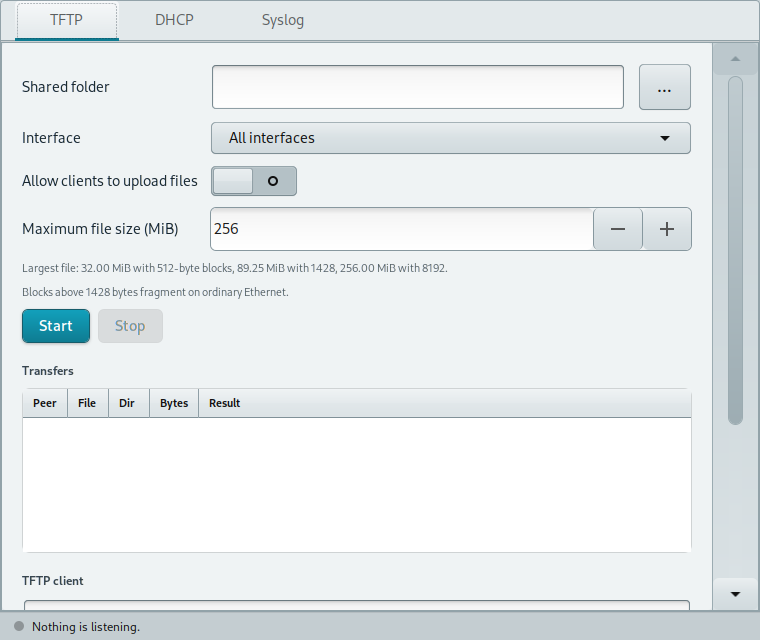
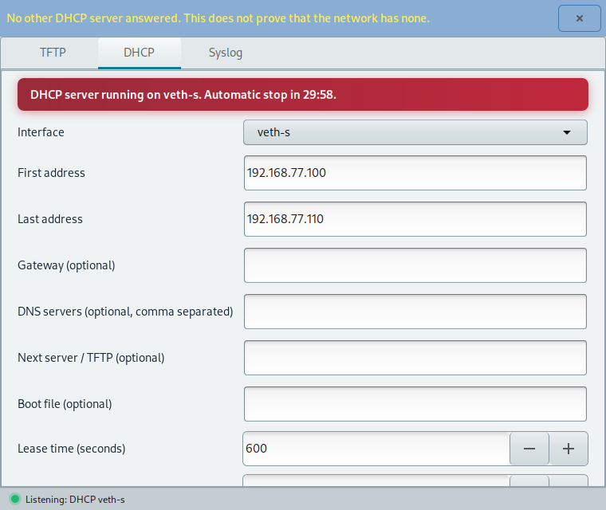
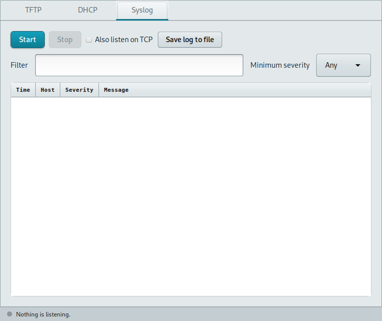

# Tftpd-GUI

**Tftpd-GUI** brings a TFTP server and client, a temporary DHCP server and a syslog collector into one GTK window. It is designed for setting up network equipment on a controlled network.







The interface is available in English, Italian, French, German and Spanish.

## Installation

On Debian 12 or newer, SysLinuxOS or a compatible system, add the [SysLinuxOS-Tools APT repository](https://github.com/fconidi/SysLinuxOS-Tools#installation-client-side), then run:

```bash
sudo apt update
sudo apt install tftpd-gui
```

Alternatively, download the Debian package from the [Releases page](https://github.com/fconidi/Tftpd-GUI/releases), then install it from the download directory:

```bash
sudo apt install ./tftpd-gui_0.1.1_all.deb
```

Other versions are listed on the [Releases page](https://github.com/fconidi/Tftpd-GUI/releases). The package needs Python 3.11 or newer, GTK 3 and polkit.

Start it from the SysLinuxOS Tools menu or run `tftpd-gui`. The service helper requests administrator authorization because DHCP, TFTP and syslog use ports below 1024. Closing the window stops the helper and its services.

## TFTP server and client

Choose a shared folder and network interface, then press **Start**. Other devices can download files from the folder over UDP port 69. Uploads are disabled until you enable **Allow clients to upload files**; an upload cannot replace an existing file. The server rejects absolute names, parent directory traversal and symbolic links. Set a maximum file size before serving large images; the default is 256 MiB.

The client section can **Get** a file from another server or **Put** a local file there. The transfer table shows peers, file names, directions, byte counts and results. TFTP has a protocol limit of `65535 × block size − 1` bytes, which can be lower than the configured size limit. Blocks above 1428 bytes may fragment on ordinary Ethernet.

## Temporary DHCP server

Use DHCP only on an isolated setup network. Select an interface with a suitable IPv4 address, enter the first and last address of the pool, and optionally enter a gateway, DNS servers, a next server and boot file. Confirm the interface and pool before starting. Tftpd-GUI probes for another DHCP server and asks for another confirmation if one answers. A silent probe does **not** prove that the network is free of DHCP servers.

The red banner shows the active server and remaining time. Automatic stop defaults to 30 minutes; **Stop** ends it sooner. The lease list shows addresses assigned while the server runs. Do not enable this server on a production network where another DHCP service may be active.

## Syslog collector

Press **Start** to receive messages on UDP port 514. Enable TCP listening if your devices send syslog over TCP. Filter by text or minimum severity, then use **Save log to file** to export the visible messages.

## Limits

The current release supports IPv4 only. It does not provide DHCPv6, DNS, FTP, HTTP, DHCP relay or a full PXE menu.

## Build

With `dpkg-deb` installed, run `python3 build-deb.py --output-dir /path/to/output`. The package is written to that directory.

## License

GPL-3.0. See [LICENSE](LICENSE).
